

  

  
  
  
  



  


<!-- 01 · Neurovision -->
<a href="https://github.com/ayoubriad1/Neurovision"></a>

  &nbsp;&nbsp;
  


<!-- 02 · MolSwapper -->
<a href="https://github.com/ayoubriad1/MolSwapper"></a>

  &nbsp;&nbsp;
  

<!-- 03 · PocketBox -->
<a href="https://github.com/ayoubriad1/pocketbox"></a>

  &nbsp;&nbsp;
  

<!-- 04 · Muscle Atlas -->

  

<!-- 05 · Plantiva Sciences -->


  

  


  

<b>🔬 Experience & initiatives</b>

 

| When | What |
|---|---|
| 2025 – 26 | **Founder** — Plantiva Sciences · interactive botanical platform for personalised medicinal mixtures |
| Jun – Sep 2025 | **Research Intern** — ONSSA Seed Certification Laboratory, Beni Mellal |
| 2025 | **Founder** — Organickly · eco-friendly biofertilizers |
| Jul 2024 – now | **Laboratory Assistant Intern** — Errazi Medical Laboratory |
| 2023 – 24 | **Head of Lab** — Enactus ADOO · olive-pomace biofertilizer |
| Aug – Oct 2023 | **Research Intern** — ORMVAT Tadla · soil & well-water analysis |
| 2023 – 24 | McKinsey Forward · Enactus Empact Bootcamp (OCP) · Agri-tech Bootcamp · Bidaya Safir Program |


  <picture>
    <source media="(prefers-color-scheme: dark)" srcset="https://raw.githubusercontent.com/ayoubriad1/ayoubriad1/output/github-contribution-grid-snake-dark.svg"/>
    <source media="(prefers-color-scheme: light)" srcset="https://raw.githubusercontent.com/ayoubriad1/ayoubriad1/output/github-contribution-grid-snake.svg"/>
    
  </picture>

